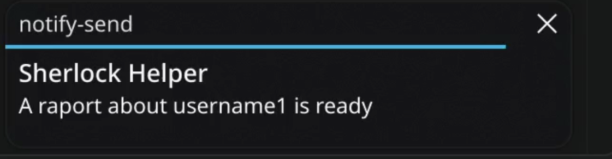
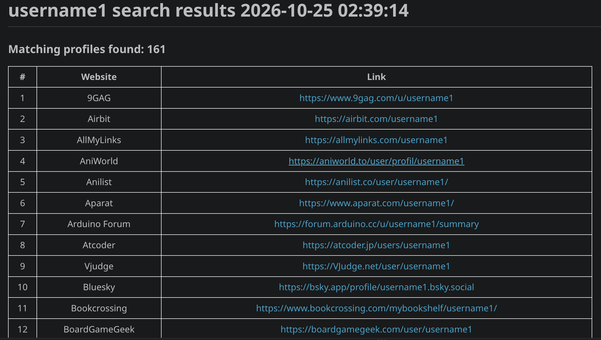
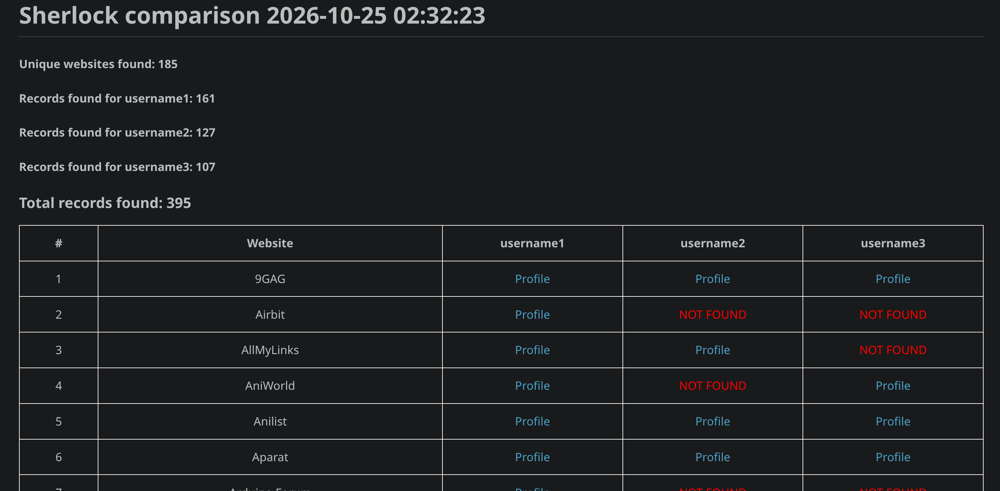
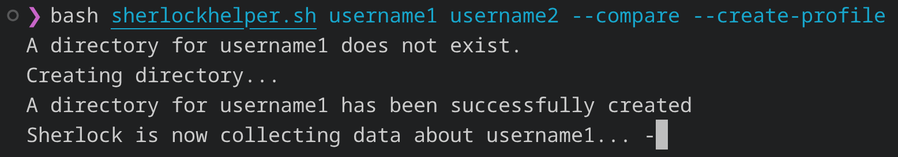
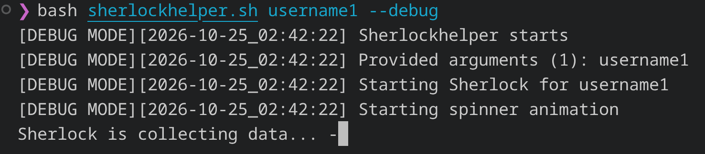
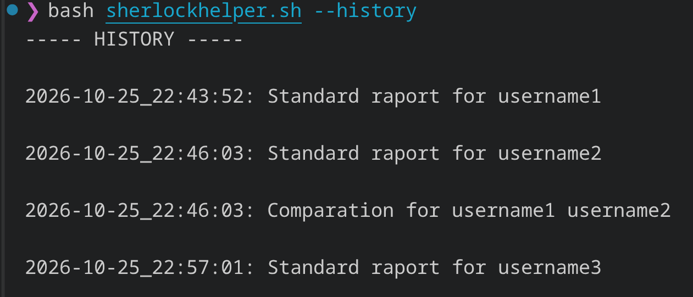

# Sherlock Helper
## Introduction
Sherlock Helper is a bash script that uses Siddharth Dushantha's Sherlock Project.

This tool is destinated to enchant your experiennce with Sherlock.

## Requirements

To run Sherlock Helper you need:

1. Linux
2. Bash
3. Having **Sherlock Project** installed.
You can download it from here: https://github.com/sherlock-project/sherlock  

For Notifications you need to install **notify-send** Read more: https://man.archlinux.org/man/notify-send.1.en

For Notification sounds you need to install **pw-play** Read more: https://linuxcommandlibrary.com/man/pw-play

## Basic usage

sherlockhelper [USERNAMES] [OPTIONS]

or

sherlockhelper [OPTION] if you use **--help**, **--history**, or **--last**

*Creates a standard raport*  

    sherlockhelper username1 username2  

*Creates a comparation*    

    sherlockhelper username1 username2 --compare  

*Creates a comparation, but also standard raports*  
 
    sherlockhelper username1 username2 --compare --create-profile

## Features
### Notifications
You can recieve a notification when a new raport is ready
If you need, you can keep it silent with **--silent-notify** or turn it off with **--no-notify**

### Standard Raports
Instead of raw text, you will get a markdown file, with a gentle HTML table.

### Compare Raports
Compare many usernames with **--compare**

### Why not both?
With **--create-profile** you can create standard raports and compare the results at once

### Debug option

This is the open source project. So if anyone would like to do something with the code, I left the **--debug** option.
It gives you an additional debug information with the exact time.

### History

In case you need to check what have you been searching for. Just type **--history**

Don't want it? No problem. You can turn it off with **--no-history**

In case you need to see only the last search, use **--last**

### Disclaimer

SherlockHelper is an independent project designed to simplify the use of Sherlock. It is intended for lawful OSINT research, educational purposes, and other legitimate uses.

Users are solely responsible for how they use this software and for complying with applicable laws, privacy regulations, and the terms of service of the websites they access.

Search results do not guarantee that a profile belongs to a particular individual. Results should be independently verified before drawing conclusions.

SherlockHelper is provided "as is", without warranty of any kind. The author is not responsible for misuse of the software or any consequences arising from its use.

SherlockHelper is an independent project and is not affiliated with, endorsed by, or officially associated with the Sherlock project.

### Support project

If you like using Sherlock Helper, and want to help me with developing the project, you can support me on Patronite right there: 
https://suppi.pl/laskowskidev

### AI Note

AI was not used to genarate Sherlock Helper's code.
As it is my first project I used AI to support me with AWK code and project's structure.
I was mostly learning from those two books:

D.Cohen, C.Sturm - *"The Software Developer's Guide to Linux. A practical, no-nonsense guide to using the Linux command line and utilities as a software developer"*

R.Blum, C.Bresnahan - *"Linux Command Line and Shell Scripting Bible"*

### License

SherlockHelper is licensed under the MIT License.

You are free to use, copy, modify, merge, publish, distribute, sublicense, and/or sell copies of the software, subject to the terms and conditions of the license.

See the LICENSE file for the full license text.
